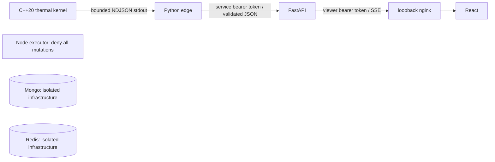

# Architecture and current boundary

Phase 1 implements only the read-only local path below. The master constitution
remains the target architecture for later phases.

## Process and trust boundaries

- Edge is the sole owner of one simulator child process. It starts from a fixed
  seed, validates every frame, requires contiguous versions and the selected seed,
  keeps only the latest frame, and gives each process run a UUID plus binary SHA-256.
- The bootstrap integration uses a narrow subprocess/NDJSON interface. It cannot
  send commands to the twin. Child timeout/exit or invalid output disables readiness.
- API polls the authenticated latest-frame endpoint at 2 Hz per viewer and emits
  SSE. There are at most eight streams. No process state is durable in Phase 1.
- API has a global 60-token read bucket with one token/second refill. Browser
  status becomes stale after 3.5 seconds without a frame; edge freshness expires
  after three seconds. Invalid/cloud data cannot create substitute measurements.
- The browser talks only to nginx on the selected loopback port (saved in `.env`).
  Nginx joins an ingress bridge plus the internal app network; API/edge/executor have no
  published host ports. Backend tokens are absent from the JavaScript bundle.
- Redis/Mongo are on a separate internal network, without app connections or host
  ports. Their admin bootstrap credentials are never passed to API/edge/executor.
- The executor is a typed Node process with a health endpoint and explicit denials.
  It has no database, GitHub, physical-device or cloud clients.

## Bootstrap physics

For each cell, `C dT/dt = P - h(T - Tc)` with `C=8000 J/K`, `h=80 W/K`,
`P=1200 W * load`, and `Tc=22 °C`. Loads range from 0.50 to 0.80.
The seed determines initial temperatures between 25.00 and 25.99 °C. There is no
noise, fault, coupling, variable flow, feeder, or thermal safety threshold yet.
Each step uses the exact constant-input solution:

`T_next = Tc + P/h + (T - Tc - P/h) * exp(-h*dt/C)`.

`dt` must be finite and in `(0,1]`; the live loop uses 0.5 simulated seconds per
frame, with a 0.5-second wall-clock sleep (scheduling overhead is not simulated).
Temperatures converge to equilibrium, so a steady reading after a long run is
physically expected. Frame versions continue increasing.

CTest verifies repeatable same-seed traces on the same build, analytic step
composition, interval energy balance, equilibrium, and rejected time steps.
Cross-compiler bit-for-bit floating point identity is not claimed.

## Contracts

Pydantic is the source for strict JSON schemas and API OpenAPI. Unknown fields,
duplicate/missing cells, coerced integer strings, nonfinite floats, invalid source
labels, and out-of-range values fail validation. TypeScript declarations are
generated with openapi-typescript and consumed by React and the Node service.
The read-only Phase 1 contracts are not final command/approval schemas.

## Later architecture

Phase 2 adds the six-cell shared coolant/feeder physics, fault universe, snapshots,
and 100 scenario descriptors. Phase 3 adds deterministic safety and FAISS.
Phase 4 adds Redis streams, Mongo events, replay, retention and tenant boundaries.
Phases 5–10 add evidence, MI300X inference, LangGraph, robust planning, WebAuthn and
independent capability-checked execution. Phase 11 extends this dashboard; Phase 12
audits the entire product and measured demo. These are planned, not implemented.
