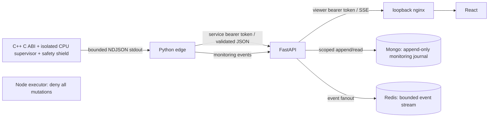

# Architecture and current boundary

Phase 4 implements the read-only local path below. The master constitution
remains the target architecture for later phases.

## Process and trust boundaries

- Edge is the sole owner of one simulator child process. It starts an isolated supervisor from a fixed
  seed, validates every frame, requires increasing versions with exactly accounted packet drops and the selected seed,
  keeps only the latest frame, and gives each process run a UUID plus binary and effective-scenario SHA-256.
- The parent uses a narrow supervisor/NDJSON interface. Only the trusted child
  shield can change its local twin emergency targets; cloud messages cannot. Child timeout/exit or invalid output disables readiness.
- API polls the authenticated latest-frame endpoint at 2 Hz per viewer and emits
  SSE. There are at most eight streams. Live state is not durable; offline snapshots are explicit local artifacts.
- API has a global 60-token read bucket with one token/second refill. Browser
  status becomes stale after 3.5 seconds without a frame; edge freshness expires
  after three seconds. Invalid/cloud data cannot create substitute measurements.
- The browser talks only to nginx on the selected loopback port (saved in `.env`).
  Nginx joins an ingress bridge plus the internal app network; API/edge/executor have no
  published host ports. Backend tokens are absent from the JavaScript bundle.
- Redis/Mongo are on the internal storage network, without published host ports.
  API joins that network with scoped monitoring append/read credentials. Admin
  bootstrap credentials are used only by a disposable migration container.
- The executor is a typed Node process with a health endpoint and explicit denials.
  It has no database, GitHub, physical-device or cloud clients.

## Coupled physics and offline rollouts

The same C++ Twin class powers the live subprocess and a versioned C ABI used
through Python ctypes for local experiments and isolated supervised execution. Six cells share coolant, pump and
feeder dynamics, with bounded actuators, seeded sensor/process/transport faults,
reset and complete state snapshots. See [equations and limits](PHYSICS.md).
No HTTP mutation endpoint exposes the ABI. Ground truth is a simulator inspection
field, not an input for future production detectors.

## Contracts

Pydantic is the source for strict JSON schemas and API OpenAPI. Unknown fields,
duplicate/missing cells, coerced integer strings, nonfinite floats, invalid source
labels, and out-of-range values fail validation. TypeScript declarations are
generated with openapi-typescript and consumed by React and the Node service.
The Phase 3 contracts are not final command/approval schemas.

## Later architecture

Phase 3 safety/FAISS/cloud-outage semantics are documented in ADR 0006.
Phase 4 adds Redis streams, Mongo events, replay, retention and tenant boundaries.
Phases 5–10 add evidence, MI300X inference, LangGraph, robust planning, WebAuthn and
independent capability-checked execution. Phase 11 extends this dashboard; Phase 12
audits the entire product and measured demo. These are planned, not implemented.

## Phase 4 persistence

ADR 0007 defines canonical Mongo events, recoverable immutable views and durable
Redis fanout receipts. The local collector runs independently of browser reads.
The AEGIS HTTPS protocol receiver is implemented with a distinct ingest token;
no operational command is accepted. Replays include exact pre-policy native state,
payload hashes and a deterministic event-page fingerprint. Reads are bounded;
`truncated` explicitly indicates replay pages larger than 100 events. Current
native incidents contain the anomaly and local-stop events for one run.
The actual C++/Python HTTP frame is also validated by Node/AJV against generated
JSON Schema; the live React path is verified separately by Playwright.
